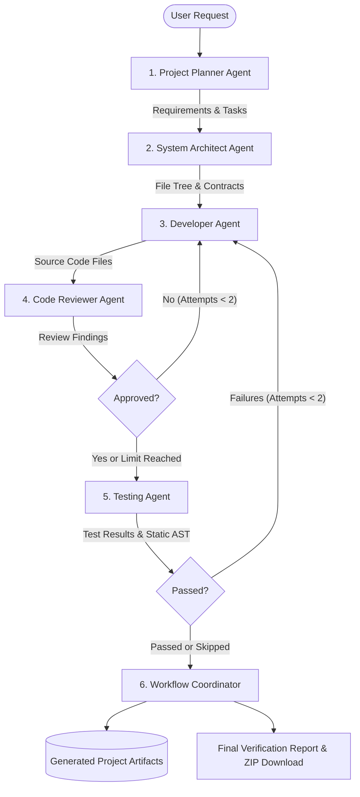

# ForgeTeam AI 🚀

> **Collaborative Multi-Agent AI Software Development Platform**  
> *Zero Paid APIs • Local-First • LangGraph Orchestrated • Docker Sandboxed*

ForgeTeam AI is an open-source, local-first multi-agent software engineering workspace. Submit a software specification, and a team of specialized AI agents collaborates through an observable, bounded state machine to plan, architect, implement, review, test, and package complete downloadable software projects.

---

## 🌟 Key Capabilities

- **Genuine Multi-Agent Collaboration:** 6 logical agents (Planner, Architect, Developer, Reviewer, Tester, Coordinator) orchestrated through a shared LangGraph state graph.
- **Feedback & Revision Loops:** When the Code Reviewer detects issues or tests fail, code is automatically routed back to the Developer Agent within configurable bounds (default: 2 revisions).
- **Zero Paid API Requirement:** Works with local models via [Ollama](https://ollama.ai) (`qwen2.5-coder:3b`) or CPU inference. No cloud keys required.
- **Built-in Demo Mode:** Instant deterministic evaluation mode that runs the entire multi-agent graph, review loops, and artifact generation without downloading models.
- **Observable Live Workspace:** Live progress tracking, stage badges, chronological collaboration logs, syntax-highlighted code explorer, and ZIP packaging.
- **Defensive Sandbox Architecture:** Untrusted code execution is sandboxed via Docker (when available) or verified via AST static analysis with transparent status reporting.

---

## 🏗️ Architecture & Collaboration Flow



---

## 🛠️ Technology Stack

| Layer | Technologies |
|---|---|
| **Backend API** | Python 3.12, FastAPI, Uvicorn, Pydantic v2, Pydantic-Settings |
| **Agent Orchestration** | LangGraph, LangChain Core |
| **Local LLM Engine** | Ollama (`qwen2.5-coder:3b`), HTTPX client |
| **Database & ORM** | SQLite, SQLAlchemy 2.0 (declarative), AioSQLite |
| **Frontend UI** | React 18, TypeScript, Vite, Tailwind CSS, Lucide Icons, React Router 6 |
| **Test Suites** | Pytest, Pytest-Asyncio, HTTPX (Backend); Vitest, React Testing Library, JSDOM (Frontend) |
| **Safety & Sandbox** | Docker (isolated test containers) & Python AST Static Analysis |

---

## 🚀 Quick Start Guide

### Prerequisites
- **Python 3.11+** installed (`python --version`)
- **Node.js 18+** & **npm** installed (`node --version`)
- *(Optional)* [Ollama](https://ollama.ai) for local LLM inference

---

### Windows (PowerShell)

#### 1. Setup Backend
```powershell
cd backend
python -m venv .venv
.\.venv\Scripts\Activate.ps1
pip install -r requirements.txt
cp .env.example .env
```

#### 2. Setup Frontend
```powershell
cd ..\frontend
npm install
```

#### 3. Run Development Stack
You can start both services with a single command:
```powershell
cd ..
powershell -ExecutionPolicy Bypass -File .\scripts\start-all.ps1
```
Or in separate terminals:
- **Backend:** `powershell -ExecutionPolicy Bypass -File .\scripts\start-backend.ps1`
- **Frontend:** `powershell -ExecutionPolicy Bypass -File .\scripts\start-frontend.ps1`

Open your browser at **`http://127.0.0.1:5173`**.

---

### Linux / macOS

```bash
# Terminal 1: Backend
cd backend
python3 -m venv .venv
source .venv/bin/activate
pip install -r requirements.txt
cp .env.example .env
python -m uvicorn app.main:app --host 127.0.0.1 --port 8000 --reload

# Terminal 2: Frontend
cd frontend
npm install
npm run dev
```

---

## 🧪 Running Automated Tests

### Backend Test Suite (Pytest)
```powershell
cd backend
python -m pytest tests -v
```
*Output: 11 passing tests covering health, API endpoints, CRUD, path traversal protection, LangGraph transitions, and agent state.*

### Frontend Test Suite (Vitest)
```powershell
cd frontend
npm test
```
*Output: 4 passing tests covering navigation, dashboard data binding, status badges, and agent cards.*

### Production Frontend Build
```powershell
cd frontend
npm run build
```

---

## 🤖 Configuring Local Ollama vs Demo Mode

### Using Demo Mode (Zero Setup)
When creating a new project in the interface, leave **Demo Mode** enabled. The workflow runs through the actual LangGraph state machine, produces realistic files, triggers reviewer feedback loops, and provides instant evaluation without downloading model weights.

### Using Real Local LLM
1. Install Ollama: `https://ollama.com`
2. Pull the recommended model:
   ```bash
   ollama pull qwen2.5-coder:3b
   ```
3. Start the service:
   ```bash
   ollama serve
   ```
4. Verify connectivity from the **Settings & Status** tab in the ForgeTeam UI.

---

## 📁 Repository Structure

```
forgeteam-ai/
├── backend/
│   ├── app/
│   │   ├── agents/          # Agent implementations & system prompts
│   │   ├── api/             # FastAPI routers (projects, runs, system)
│   │   ├── core/            # Config & environment settings
│   │   ├── graph/           # LangGraph workflow & state schema
│   │   ├── models/          # SQLAlchemy database models
│   │   ├── schemas/         # Pydantic request/response contracts
│   │   ├── services/        # Ollama client, artifacts, test executor
│   │   ├── database.py      # SQLite session & table initialization
│   │   └── main.py          # FastAPI application entry point
│   ├── tests/               # Backend Pytest suite
│   ├── requirements.txt     # Python dependencies
│   └── .env.example         # Safe environment template
├── frontend/
│   ├── src/
│   │   ├── api/             # Typed API client
│   │   ├── components/      # Reusable UI components
│   │   ├── layouts/         # Main layout with sidebar & header
│   │   ├── pages/           # Dashboard, CreateProject, Workspace, History, Settings
│   │   ├── styles/          # Tailwind & dark theme styling
│   │   └── types/           # TypeScript contract interfaces
│   ├── tests/               # Vitest test suite
│   ├── package.json
│   └── vite.config.ts
├── generated_projects/      # Isolated project directories per run
├── scripts/                 # Development startup automation scripts
├── docs/                    # Architecture, API, Security, Troubleshooting
├── .gitignore
├── LICENSE
└── README.md
```

---

## 📄 License
This project is licensed under the [MIT License](LICENSE).
