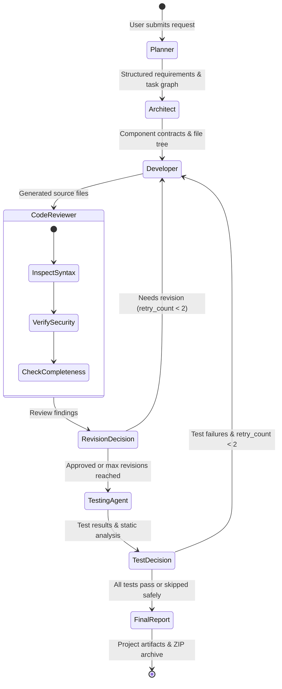
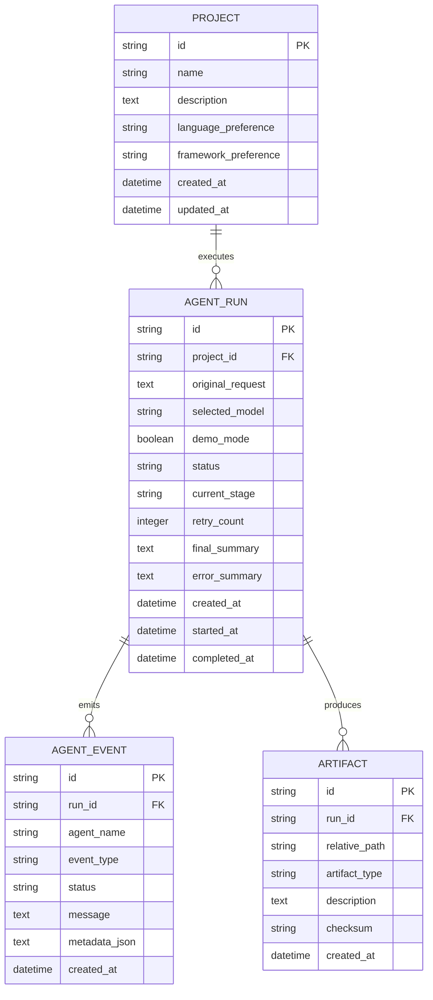

# ForgeTeam AI — System Architecture

ForgeTeam AI is a local-first, zero-paid-API collaborative multi-agent software development platform. It orchestrates a specialized team of autonomous AI agents through a shared state graph to transform high-level software requirements into structured, reviewed, tested, and downloadable software repositories.

---

## 1. Multi-Agent Workflow State Diagram

---

## 2. Agent Responsibilities & Output Contracts

| Agent | Responsibility | Core Deliverables |
|---|---|---|
| **1. Project Planner** | Breaks user ideas into requirements, priority-ranked tasks, acceptance criteria, and constraints. | `plan.json`, tasks, acceptance checklist |
| **2. System Architect** | Determines system layout, module responsibilities, API outline, and database schemas. | `architecture.json`, file tree, data models |
| **3. Developer Agent** | Generates real, functional source code files adhering to architecture blueprints. | Source files (`src/`, `models/`, `routers/`) |
| **4. Code Reviewer** | Inspects code for logic defects, security risks, syntax errors, and missing error handling. | `review_report.json`, severity-ranked findings |
| **5. Testing Agent** | Performs AST structure verification, creates unit tests, checks contract compatibility. | `test_report.json`, test files (`tests/`) |
| **6. Workflow Coordinator** | Coordinates graph transitions, manages shared typed state, writes disk artifacts, compiles summary. | `final_report.md`, ZIP distribution archive |

---

## 3. Data Architecture & Relational Schema

---

## 4. Hardware Sizing & Memory Management

- **Single Model Instance:** All agents share one local model endpoint (`http://127.0.0.1:11434`) with role-specific system prompts.
- **Sequential Execution:** Agents execute sequentially to keep VRAM usage under 4 GB.
- **CPU Compatibility:** If GPU offloading is not supported, Ollama seamlessly executes inference on CPU cores without software modifications.
- **Demo Mode:** Full zero-model testing mode uses deterministic, realistic agent payloads to test UI and graph state transitions without loading LLM weights.
